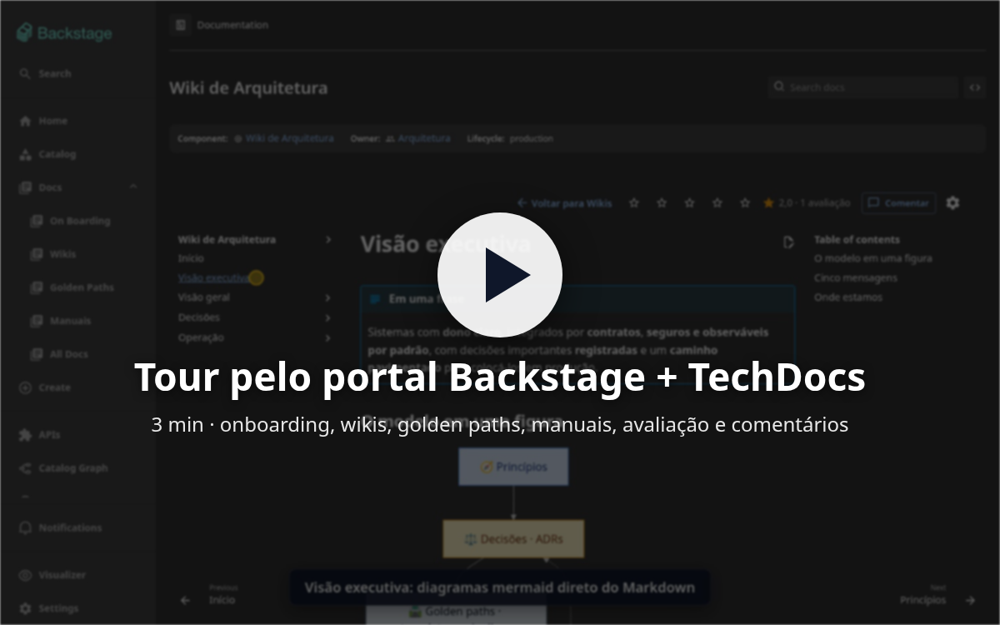
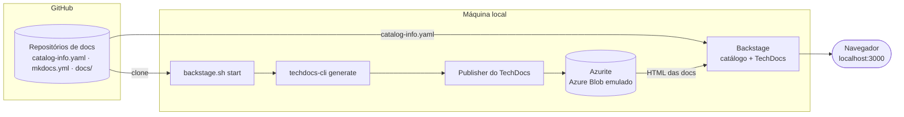

# Backstage + TechDocs

Portal de documentação baseado no [Backstage](https://backstage.io) e no
[TechDocs](https://backstage.io/docs/features/techdocs/), no modelo *docs-as-code*. A documentação
fica em Markdown, no repositório de cada time, e é gerada fora do Backstage e publicada num
**Azure Blob Storage** (emulado localmente pelo Azurite). O Backstage só lê e exibe.

Sobe com **um comando**, numa máquina Linux ou WSL2:

```bash
./backstage.sh start      # http://localhost:3000
```

## Demonstração

[](https://github.com/edtroleis/backstage-techdocs-poc/releases/download/v1.0.0/backstage-techdocs-tour.mp4)

**[▶ Assistir ao tour (MP4, 3 min, 11 MB)](https://github.com/edtroleis/backstage-techdocs-poc/releases/download/v1.0.0/backstage-techdocs-tour.mp4)**:
onboarding, wikis com diagramas, avaliação com estrelas, os dois jeitos de comentar, golden paths,
manuais com selo de status, serviço com doc, serviço sem doc (guia passo a passo), All Docs e busca.

---

## Sumário

- [Demonstração](#demonstração)
- [O que tem no portal](#o-que-tem-no-portal)
- [Arquitetura](#arquitetura)
- [Pré-requisitos](#pré-requisitos)
- [Início rápido](#início-rápido)
- [Comandos](#comandos)
- [Repositórios de documentação](#repositórios-de-documentação)
- [Como documentar um novo componente](#como-documentar-um-novo-componente)
- [Estrutura do projeto](#estrutura-do-projeto)
- [Configuração](#configuração)
- [Login com GitHub (opcional)](#login-com-github-opcional)
- [Solução de problemas](#solução-de-problemas)
- [Limitações conhecidas](#limitações-conhecidas)
- [Especificações](#especificações)
- [Licença](#licença)

---

## O que tem no portal

| Recurso | Descrição |
|---------|-----------|
| **Menu Docs** | Seções On Boarding, Wikis, Golden Paths, Manuais e All Docs |
| **Páginas de cards** | Montadas a partir do catálogo: categoria, título, descrição, tópicos e selo de status |
| **Selo de status** | 🟢 Produtivo · 🟡 Em construção · 🔴 Descontinuado (a partir do `spec.lifecycle`) |
| **Diagramas** | Mermaid (renderizado no navegador) e PlantUML (renderizado no build) |
| **Avaliação** | 1 a 5 estrelas em toda doc, com média; nota baixa pede o motivo |
| **Comentários** | Botão **Comentar** e seleção de trecho, os dois abrindo uma issue no GitHub da doc |
| **Voltar para a seção** | Link "← Voltar para Wikis/Golden Paths/Manuais" no topo da doc |
| **Componente sem doc** | A aba TechDocs mostra um passo a passo já preenchido para criar e publicar a doc |
| **Times** | 6 grupos com membros, docs que cada um é dono e avaliações por time |
| **Busca** | Encontra texto dentro de todas as docs |

---

## Arquitetura



- **Builder externo** (`techdocs.builder: external`): o Backstage não gera as docs. O CI de cada
  repositório valida o build; a publicação é feita pelo script local.
- **Publisher Azure Blob:** o mesmo código de publicação do Backstage (`@backstage/plugin-techdocs-node`),
  apontado para o Azurite por *connection string*. Em produção, só a connection string muda.

---

## Pré-requisitos

| Ferramenta | Versão | Para quê | Verificar |
|------------|--------|----------|-----------|
| Linux ou **WSL2** | Fedora, Ubuntu… | Sistema operacional | `uname -a` |
| **Git** | 2.30+ | Clonar os repositórios | `git --version` |
| **GitHub CLI** | 2.x, **autenticado** | Token para o catálogo ler o GitHub | `gh auth status` |
| **nvm** | 0.39+ | Instala e usa o Node 24 automaticamente | `command -v nvm` |
| **Python** | 3.10+ com `venv` | Gera as docs (MkDocs + techdocs-core) | `python3 --version` |
| **Podman** | 4+ | Roda o Azurite (Azure Blob emulado) | `podman info` |
| **curl** e **ss** (iproute2) | qualquer | Downloads e verificação de portas | `curl --version` |
| Java *(opcional)* | 17+ | Diagramas PlantUML | `java -version` |

Também é preciso ter **~4 GB livres** em disco e as **portas 3000, 7007 e 10000** livres.

<details>
<summary><b>Instalação dos pré-requisitos</b></summary>

**Fedora**

```bash
sudo dnf install -y git gh python3 podman curl iproute java-21-openjdk-headless
```

**Ubuntu / Debian**

```bash
sudo apt update && sudo apt install -y git gh python3 python3-venv podman curl iproute2 openjdk-21-jre-headless
```

**nvm** (qualquer distribuição)

```bash
curl -o- https://raw.githubusercontent.com/nvm-sh/nvm/v0.40.3/install.sh | bash
# abra um novo terminal
```

**Login no GitHub**

```bash
gh auth login
```

</details>

> **WSL2:** mantenha o projeto no filesystem do Linux (ex.: `~/code`), não em `/mnt/c`.
> O acesso a arquivos do Windows pelo WSL é muito mais lento.

---

## Início rápido

```bash
git clone https://github.com/edtroleis/backstage-techdocs-poc.git backstage
cd backstage
./backstage.sh start
```

Abra **http://localhost:3000** e clique em **Enter** (login como guest).

| | Primeira execução | Próximas |
|---|---|---|
| Tempo do `start` | ~3 a 5 min (dependências e publicação de todas as docs) | ~20 s |

Para parar: `./backstage.sh stop`. Para remover tudo que foi criado: `./backstage.sh delete`.

---

## Comandos

| Comando | O que faz |
|---------|-----------|
| `./backstage.sh start` | Verifica os pré-requisitos; instala Node 24, dependências, ambiente Python e PlantUML (se faltarem); clona ou atualiza os repositórios de docs em `repos/`; sobe o Azurite; publica as docs **que mudaram**; sobe o Backstage e espera ficar pronto |
| `./backstage.sh stop` | Para o Backstage (o grupo de processos inteiro) e o Azurite |
| `./backstage.sh delete` | Pede confirmação e remove tudo que o `start` criou (`-y` para não perguntar) |
| `./backstage.sh status` | Mostra se o Backstage e o Azurite estão rodando |
| `./backstage.sh logs` | Acompanha o log do Backstage |

**O que o `delete` remove:** `repos/`, o container e o volume do Azurite, `.venv/`, `.tools/`,
`.run/`, `techdocs-storage/`, `app/node_modules` e o banco local (`app/packages/backend/sqlite-data`,
com as avaliações). **Não remove** o código, as specs, os scripts nem ferramentas globais (Node via
nvm, Podman, Java).

**Docs atualizadas:** a cada `start`, os repositórios são atualizados (`git pull`) e só os que
mudaram desde a última publicação são publicados de novo.

---

## Repositórios de documentação

Clonados em `repos/` a partir de [`scripts/repos.txt`](scripts/repos.txt). Cada um tem o próprio
repositório no GitHub e um CI que valida o build das docs.

| Repositório | Docs | Tipo | Time dono |
|-------------|------|------|-----------|
| [techdocs-onboarding](https://github.com/edtroleis/techdocs-onboarding) | Onboarding de TI | onboarding | Pessoas e Cultura |
| [techdocs-wikis](https://github.com/edtroleis/techdocs-wikis) | Arquitetura, Governança, Compliance, IA | wiki | Arquitetura · Governança e Compliance · Dados e IA |
| [techdocs-golden-paths](https://github.com/edtroleis/techdocs-golden-paths) | Serviços, Frontend | golden-path | Platform Team |
| [techdocs-manuais](https://github.com/edtroleis/techdocs-manuais) | WSL/RHEL, Podman Desktop, RHEL, OpenShift Dev Spaces | manual | Platform Team |
| [techdocs-pedidos-service](https://github.com/edtroleis/techdocs-pedidos-service) | Pedidos Service (serviço **com** doc) | service | Squad Checkout |
| [techdocs-pagamentos-service](https://github.com/edtroleis/techdocs-pagamentos-service) | Pagamentos Service (serviço **sem** doc) | service | Squad Checkout |
| [techdocs-demo-service](https://github.com/edtroleis/techdocs-demo-service) | Demo Service + API | service | Platform Team |
| [techdocs-wiki-engineering](https://github.com/edtroleis/techdocs-wiki-engineering) | Wiki de Engenharia | documentation | Arquitetura |
| [techdocs-wiki-onboarding](https://github.com/edtroleis/techdocs-wiki-onboarding) | Onboarding do Dev | documentation | Pessoas e Cultura |
| [techdocs-wiki-golden-path](https://github.com/edtroleis/techdocs-wiki-golden-path) | Golden Path (versão inicial) | documentation | Platform Team |

Os times (grupos) e as pessoas (fictícias) estão em [`catalog/org.yaml`](catalog/org.yaml).

---

## Como documentar um novo componente

1. Abra o componente no catálogo, aba **TechDocs**. Sem doc, ela mostra um **guia passo a passo**
   já preenchido com o nome do componente, com botões que criam os arquivos direto no GitHub.
2. No repositório do componente: `mkdocs.yml`, `docs/index.md` e a anotação
   `backstage.io/techdocs-ref: dir:.` no `catalog-info.yaml`. Modelos em [`templates/`](templates/).
3. Registre o repositório:
   - em `app/app-config.yaml` (`catalog.locations`), para o catálogo ler o componente;
   - em `scripts/repos.txt`, para o `start` clonar e publicar as docs.
4. Rode `./backstage.sh start`. Se o Backstage já estiver rodando, faça `stop` e `start`.

Recursos de escrita (abas, cards, botões, figuras, mermaid, PlantUML) e o que funciona no leitor
do TechDocs: [specs/05-portal-docs.md](specs/05-portal-docs.md).

---

## Estrutura do projeto

```text
.
├── backstage.sh               # start / stop / delete / status / logs
├── app/                       # app Backstage (novo frontend system)
│   ├── app-config.yaml        # catálogo, TechDocs (publisher local), páginas e cards
│   ├── app-config.azurite.yaml# overlay: TechDocs lendo do Azure Blob (usado pelo start)
│   ├── app-config.github-auth.yaml # overlay: login com GitHub (se houver credenciais)
│   └── packages/app/src/modules/
│       ├── docsPortal/        # páginas de cards, addon do topo das docs, guia "sem doc"
│       ├── signIn/            # página de login: GitHub (opcional) + guest
│       └── nav/               # menu lateral com o grupo Docs
├── catalog/org.yaml           # times, pessoas e o System de exemplo
├── scripts/
│   ├── repos.txt              # repositórios de docs clonados e publicados
│   ├── techdocs-publish.sh    # gera (techdocs-cli) e publica (disco ou Azurite)
│   ├── techdocs-azure-publish.cjs  # publica no Blob via Publisher do Backstage
│   ├── azurite.sh             # Azurite no Podman (up/down/status/env)
│   └── record-tour.cjs        # grava um vídeo de tour pelo portal (Playwright)
├── templates/                 # arquivos-base para um repositório de docs
├── specs/                     # especificações e decisões (00 a 05)
└── requirements.txt           # versão do mkdocs-techdocs-core
```

Criados pelo `start` (ignorados pelo git): `repos/`, `.venv/`, `.tools/` (PlantUML), `.run/`
(PID, logs e marcadores de publicação), `app/node_modules/` e `app/packages/backend/sqlite-data/`.

---

## Configuração

| Item | Onde | Observação |
|------|------|------------|
| Token do GitHub | variável `GITHUB_TOKEN` | Se não definida, o `start` usa `gh auth token`. Nunca é gravada em arquivo |
| Variáveis locais | `.env` (modelo em `.env.example`) | Carregado pelo `backstage.sh`; ignorado pelo git |
| Login com GitHub | `app/app-config.github-auth.yaml` | Carregado só se `AUTH_GITHUB_CLIENT_ID` e `AUTH_GITHUB_CLIENT_SECRET` existirem |
| Publisher do TechDocs | `app/app-config.azurite.yaml` | Azure Blob, container `techdocs`, connection string do Azurite |
| Banco do Backstage | `app/app-config.yaml` → `backend.database` | SQLite em arquivo (persiste avaliações entre restarts) |
| Repositórios no catálogo | `app/app-config.yaml` → `catalog.locations` | Um `catalog-info.yaml` por repositório |
| Versões | `backstage.sh`, `requirements.txt` | Node 24, mkdocs-techdocs-core 1.7.1, PlantUML 1.2026.8, techdocs-cli 1.13.0, Azurite 3.37.0 |

**Para o Azure real:** crie a storage account e o container `techdocs`, troque a connection string
(ou use `credentials.accountName` com managed identity) e publique pelo CI com
`techdocs-cli publish --publisher-type azureBlobStorage`. Detalhes em
[specs/04](specs/04-techdocs-blob-azurite.md).

---

## Login com GitHub (opcional)

Por padrão, o login é como **guest**. Com um OAuth App do GitHub, a página de login passa a
mostrar **GitHub e Guest**, e cada pessoa entra com a própria conta. Assim as avaliações somam
pessoas diferentes e o filtro **Owned** mostra as docs do seu time.

1. Crie um OAuth App em <https://github.com/settings/applications/new>:

   | Campo | Valor |
   |-------|-------|
   | Application name | `Backstage local` (qualquer nome) |
   | Homepage URL | `http://localhost:3000` |
   | Authorization callback URL | `http://localhost:7007/api/auth/github/handler/frame` |

2. Gere um *client secret* e grave as credenciais no `.env` (ignorado pelo git):

   ```bash
   cp .env.example .env
   # edite .env: AUTH_GITHUB_CLIENT_ID=... e AUTH_GITHUB_CLIENT_SECRET=...
   ```

3. Reinicie: `./backstage.sh stop && ./backstage.sh start`. A mensagem final mostra
   `login: GitHub ou guest`.

Quem entra com o GitHub vira `user:default/<login>`. Se esse usuário existir em
[`catalog/org.yaml`](catalog/org.yaml), ele herda os times (ex.: `edtroleis` → Platform Team).
Contas que não estão no catálogo também entram, porque o resolver usa
`dangerouslyAllowSignInWithoutUserInCatalog`; em produção, remova essa opção.

---

## Solução de problemas

| Sintoma | Causa provável | Solução |
|---------|----------------|---------|
| `Pré-requisitos ausentes: …` | Ferramenta não instalada | Veja [Pré-requisitos](#pré-requisitos) |
| `GitHub CLI sem login` | `gh` não autenticado | `gh auth login` |
| `Podman não responde` | Serviço do Podman parado | `podman info`; no Windows, inicie a Podman machine |
| `yarn install falhou` | Rede ou versão do Node | Veja `.run/yarn-install.log` |
| Porta 3000/7007 em uso | Outro processo | `ss -ltnp \| grep -E ':(3000\|7007)'`; restos deste projeto são encerrados pelo `start`/`stop` |
| Doc não atualiza | Ainda não publicada ou cache | Faça push no repositório e rode `stop` + `start` |
| Componente novo não aparece | Catálogo ainda não releu | Aguarde alguns minutos ou use **⋮ → Refresh** na página |
| Diagrama PlantUML não aparece | Java ausente | Instale o Java e rode `stop` + `start` |
| Algo estranho no geral | — | `./backstage.sh logs`, ou `./backstage.sh delete -y && ./backstage.sh start` |

---

## Limitações conhecidas

- **Sem login com GitHub configurado**, todos entram como guest (o mesmo usuário): as avaliações
  não somam pessoas e o filtro "Owned" fica vazio. Veja [Login com GitHub](#login-com-github-opcional).
- **Publicação local:** neste ambiente as docs são publicadas pelo `start`. Em produção, o CI de
  cada repositório publicaria direto no Azure Blob.
- **Textos em inglês de terceiros:** parte do diálogo de avaliação (plugin `entity-feedback`) e o
  valor do lifecycle no cabeçalho das docs (`production`, `experimental`, `deprecated`).
- **Plugins não suportados** no `mkdocs.yml` são removidos pelo `techdocs-cli` sem erro; o modo
  `strict: true` faz o build falhar em links e navegação quebrados.

---

## Especificações

| Spec | Conteúdo |
|------|----------|
| [00 · Visão geral](specs/00-overview.md) | Objetivo, escopo e decisões |
| [01 · Instalação](specs/01-backstage-install.md) | Backstage, catálogo e GitHub |
| [02 · TechDocs](specs/02-techdocs.md) | Builder externo, publisher local, CI |
| [03 · Repositórios de docs](specs/03-repos-docs.md) | Repositórios iniciais e conteúdo |
| [04 · Azure Blob (Azurite)](specs/04-techdocs-blob-azurite.md) | Publisher Azure Blob emulado |
| [05 · Portal de docs](specs/05-portal-docs.md) | Menu, cards, diagramas, avaliação, comentários, times |

### Gravar o vídeo de tour

Com o Backstage rodando, e o Chromium do Playwright instalado
(`cd app && npx playwright install chromium`):

```bash
mkdir -p .run/video
node scripts/record-tour.cjs app .run/video   # gera .run/video/techdocs-tour.webm
```

---

## Licença

[MIT](LICENSE): use, copie, modifique e distribua à vontade, mantendo o aviso de copyright.
