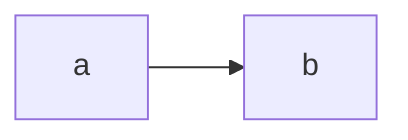
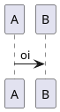

# 05 — Portal de documentação (menu Docs, cards, diagramas)

Reproduz o portal de referência: menu **Docs** com seções (On Boarding, Wikis, Golden Paths,
Manuais, All Docs), páginas de cards por categoria e diagramas mermaid/PlantUML nas docs.

## Decisões

| # | Decisão | Escolha | Motivo |
|---|---------|---------|--------|
| P1 | Kind das docs | `Component` com `spec.type` = `onboarding`, `wiki`, `golden-path`, `manual` | Sem código de backend; a referência usa um kind custom `Documentation`, que exigiria um processor |
| P2 | Repos | Um por categoria, várias docs por repo | Mostra o padrão multi-docs com poucos repos |
| P3 | Repos antigos | Mantidos (`techdocs-wiki-*`) | Coexistem; aparecem em All Docs com `type: documentation` |
| P4 | Cards | Dados do catálogo, não fixos no código | Doc nova aparece sozinha ao ser registrada |
| P5 | Mermaid | Addon de frontend `backstage-plugin-techdocs-addon-mermaid` 0.29.0 + fence `class="mermaid"` | Renderiza no navegador; o fence torna a detecção explícita |
| P6 | PlantUML | `plantuml_markdown` (já no techdocs-core) + PlantUML 1.2026.8 local | Renderizado no build como PNG embutido; não depende de servidor externo |

## Repositórios

| Repo | Entidades (`spec.type`) |
|------|-------------------------|
| `techdocs-onboarding` | `onboarding-ti` (onboarding) |
| `techdocs-wikis` | `wiki-arquitetura`, `wiki-governanca`, `wiki-compliance`, `wiki-ia` (wiki) |
| `techdocs-golden-paths` | `golden-path-servicos`, `golden-path-frontend` (golden-path) |
| `techdocs-manuais` | `manual-wsl`, `manual-podman-desktop`, `manual-rhel` (manual) |

Num repo com várias docs, cada entidade aponta para a sua pasta (`backstage.io/techdocs-ref: dir:./<pasta>`),
que tem o próprio `mkdocs.yml`. O `scripts/techdocs-publish.sh` e o workflow de CI iteram sobre todas.

## Metadados dos cards

```yaml
metadata:
  title: Wiki de Arquitetura                  # título do card
  description: Tudo o que você precisa ...     # texto do card
  annotations:
    portal.local/category: Arquitetura         # rótulo em caixa alta no topo do card
    portal.local/topics: Visão geral, Decisões, Operação   # chips
spec:
  type: wiki                                   # em qual página o card aparece
```

## Frontend (`app/packages/app/src/modules/`)

| Arquivo | O que faz |
|---------|-----------|
| `docsPortal/index.tsx` | Rotas `/portal/wikis`, `/portal/golden-paths`, `/portal/manuais` (`PageBlueprint`, `noHeader`) |
| `docsPortal/DocsCardsPage.tsx` | Busca `kind=Component, spec.type=<tipo>` no catálogo e monta os cards |
| `nav/DocsNavGroup.tsx` | Menu Docs expansível; On Boarding aponta direto para a doc; All Docs = `/docs` (`end`) |
| `nav/Sidebar.tsx` | Insere o grupo e tira `page:techdocs` da lista genérica |

`app-config.yaml`: `page:techdocs` com `initialFilter: all`. Sem isso, o All Docs abre no filtro
"Owned", que fica vazio para o guest.

## Diagramas

````markdown



````

`mkdocs.yml` de cada doc:

```yaml
markdown_extensions:
  - pymdownx.superfences:
      custom_fences:
        - name: mermaid
          class: mermaid
          format: !!python/name:pymdownx.superfences.fence_code_format
```

- **Local:** `~/.local/bin/plantuml`, um wrapper para `~/.local/share/plantuml/plantuml.jar`, roda no Java 25 do sdkman.
- **CI:** `sudo apt-get install -y plantuml`.

## Validação (2026-10-21)

| Critério | Resultado |
|----------|-----------|
| 14 docs geram em `strict` | ok, local e nos 8 workflows do GitHub |
| Cards por página | Manuais 3, Wikis 4, Golden Paths 2 (screenshot headless) |
| All Docs | 14 docs, filtro "All" |
| Mermaid | SVG desenhado em `demo-service/architecture` e `wiki-arquitetura/.../camadas-integracoes` |
| PlantUML | Imagem gerada em `demo-service/architecture` |
| Menu | Item ativo correto; All Docs não acende dentro de uma doc |

Validação visual feita com Playwright (Chromium headless). As bibliotecas do Chromium foram
instaladas via `dnf` (Fedora 43).

## Atualizações (2026-10-21, tarde)

### Wiki de Arquitetura para apresentações

Padrão visual em todas as páginas: **"Em uma frase"** (admonition `abstract`) → **figura numerada
com legenda** → conteúdo → **"Na prática"** → **"Leia também"**. A capa tem botões, uma figura SVG
(`docs/assets/arquitetura-referencia.svg`), "Em números" e cards; há uma página nova de **Visão executiva**.
São 14 figuras, todas com a mesma paleta: canal azul, serviço verde, dados roxo, decisão âmbar e risco vermelho.

O que funciona no leitor do TechDocs (testado no navegador):

| Recurso | Sintaxe | Funciona |
|---------|---------|:--------:|
| Grid cards | `<div class="grid cards" markdown>` | ✅ |
| Abas | `=== "Título"` | ✅ (diagramas fora das abas) |
| Botões | `[x](y){ .md-button .md-button--primary }` | ✅ |
| Figura com legenda | `<figure markdown>` + `<figcaption>` + `{ width="100%" }` | ✅ |
| Cores no mermaid | `classDef` / `%%{init: ...}%%` | ✅ |
| Ícones `:material-…:` | emoji shortcodes | ❌ use emoji Unicode |

Lições do mermaid: `direction` dentro de um `subgraph` é ignorada quando os nós dele se ligam para
fora. Ligue nós (não subgraphs) e prefira `flowchart TB`. Diagramas `LR` largos e `journey` ficam
ilegíveis na largura do TechDocs.

### Manual OpenShift Dev Spaces

`techdocs-manuais/dev-spaces` (entidade `manual-dev-spaces`), com uma seção de **Onboarding**
(trilha, 30 min, dia 1, semana 1), uso (workspaces, devfile, editores, boas práticas), administração
e problemas comuns. Linkado a partir do Onboarding de TI.

### Navegação "Voltar para <seção>"

Addon do TechDocs `DocsSubheaderAddon` (`modules/docsPortal`, módulo `pluginId: 'techdocs'`, posição
`Subheader`). Usa o `spec.type` da doc: wiki → Wikis, golden-path → Golden Paths, manual → Manuais.
Outros tipos (ex.: service) não mostram o link.

### Comentários nas docs

Há duas formas, as duas abrindo uma issue no GitHub do repositório da doc (exigem login no GitHub):

| Forma | Onde | Como |
|-------|------|------|
| Botão **💬 Comentar** | Topo de toda doc, ao lado de "Voltar para…" | Issue com título `Comentário: <doc> · <página>` e o link da página no corpo |
| **Open new Github issue** | Ao selecionar um trecho (addon ReportIssue, já ativo) | Issue com o trecho selecionado citado |

O botão faz parte do `DocsSubheaderAddon` (`modules/docsPortal/DocsSubheaderAddon.tsx`), que também
desenha o "Voltar para <seção>". Ele usa a anotação `github.com/project-slug`; docs sem essa anotação
não mostram o botão.

### Avaliação de 1 a 5 estrelas

Plugin da comunidade **entity-feedback**: frontend `@backstage-community/plugin-entity-feedback`
0.24.0 e backend `@backstage-community/plugin-entity-feedback-backend` 0.25.0.

| Onde | O quê |
|------|-------|
| Topo de toda doc (`DocRating.tsx`, dentro do `DocsSubheaderAddon`) | 5 estrelas + média ("★ 4,5 · 2 avaliações") |
| Nota ≤ 2 | Diálogo "O que podemos melhorar nesta documentação?" com motivos em PT |
| Página do componente | Card **Avalie** (`entity-card:entity-feedback/ratings-buttons`, `variant: starred`) e aba **Feedback** com respostas |

- Um voto por pessoa por doc; votar de novo substitui o anterior.
- Com **guest login, todos são o mesmo usuário** (`user:development/guest`): na PoC, cada voto
  substitui o anterior. Com login real (GitHub/SSO), cada pessoa conta separadamente.
- O banco passou de `:memory:` para **SQLite em arquivo** (`app/packages/backend/sqlite-data/`,
  gitignored), para as avaliações sobreviverem a restarts.
- Limitação: os textos fixos do diálogo do plugin ("Select all that apply", "Additional comments",
  "Submit") são em inglês e não têm tradução.

### Componente sem documentação: guia na aba TechDocs

A aba TechDocs de uma entidade **sem** `backstage.io/techdocs-ref` mostra um passo a passo em PT
(`DocsHowToEmptyState.tsx`), no lugar do "Missing Annotation". Ele sobrescreve a extensão
`empty-state:techdocs/entity-content`, que é a entrada `emptyState` de `entity-content:techdocs`.

Os 5 passos já vêm preenchidos com o nome e o tipo da entidade: `mkdocs.yml`, `docs/index.md`,
anotação no `catalog-info.yaml`, workflow de CI e publicação (`scripts/techdocs-publish.sh`) + Refresh.
Se a entidade tem `github.com/project-slug`, botões criam ou editam os arquivos direto no GitHub.

Exemplos (System `demo-system`):

| Serviço | Repo | Docs |
|---------|------|------|
| `pedidos-service` | `techdocs-pedidos-service` | ✅ nasceu sem docs e ganhou docs seguindo o guia (2º commit) |
| `pagamentos-service` | `techdocs-pagamentos-service` | ❌ sem docs: a aba TechDocs mostra o guia |

### Times (grupos) e owners

`catalog/org.yaml` tem 6 grupos, cada um com 2 pessoas fictícias (`kind: User`, liberado em
`catalog.rules`; **regras só valem após reiniciar o backend**):

| Grupo | Docs que é dono |
|-------|-----------------|
| Platform Team | Golden paths, Manuais (4), Golden Path de Arquitetura (antigo), Demo Service/API, Demo System |
| Arquitetura | Wiki de Arquitetura, Wiki de Engenharia |
| Governança e Compliance | Wiki de Governança, Wiki de Compliance |
| Dados e IA | Wiki de Inteligência Artificial |
| Squad Checkout | Pedidos Service, Pagamentos Service |
| Pessoas e Cultura | Onboarding de TI, Onboarding do Dev |

A página de cada grupo mostra membros, docs (ownership) e o card **"Avaliações das docs do time"**
(`entity-card:entity-feedback/ratings-table`, `variant: starred`).
